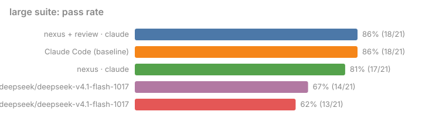
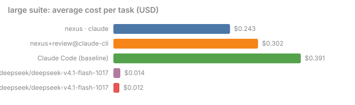
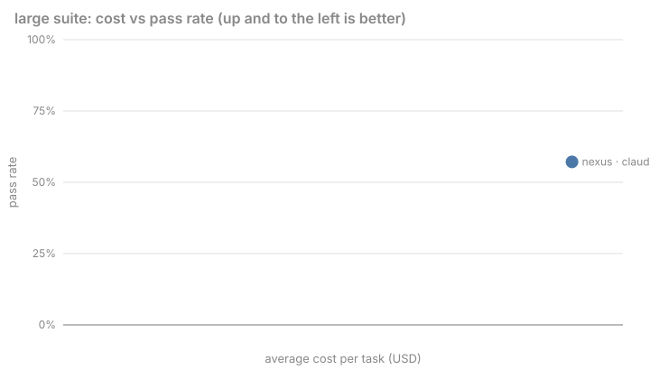

# Nexus-Agent

**Turn any repository into a software factory. Describe changes in plain English; Nexus makes them, one at a time or
many in parallel, checks and reviews each one, and keeps only the ones that pass.**

It works with any programming language and any AI model, and sends the model only the code that matters, so each
change costs less.

## The idea in three steps

| Step | Command | What happens |
|---|---|---|
| **1. Prepare the repository** | `nexus init` | Detects the stack, commands and environments, then writes the instructions and skills every coding agent reads. Nexus, Claude Code, Codex, Cursor, Copilot and Gemini all follow the same rules. |
| **2. Make a change** | `nexus run "<task>"` | The agent finds the few pieces of code the task needs, edits them, runs the project's checks, reviews its own diff and fixes what it finds. |
| **3. Make many changes safely** | `nexus factory run "<task>" "<task>" ...` | Runs step 2 for each task in its own branch, in parallel when the tasks touch different code. Mechanical gates decide what is accepted, not the model. |

Use step 2 alone for a single change. Use all three to hand a repository a backlog.

**Results on real repositories** (7 tasks × 3 runs, hidden tests the agent never sees):

| Configuration | Passed | Cost per task |
|---|---|---|
| Nexus with Claude | **18/21** | $0.24 |
| Claude Code (baseline) | 17/21 | $0.39 |
| Nexus with DeepSeek | 13/21 | **$0.012** |

Full method and every run: [benchmarks/REPORT.md](benchmarks/REPORT.md).

## Install

Needs **Node.js 22.18 or newer**, which runs the TypeScript sources directly, with no build step.

```bash
git clone https://github.com/narinzar/nexus-agent
```
```bash
cd nexus-agent && npm install && npm link
```

`npm link` gives you a global `nexus` command. Without it, use `node bin/nexus.mjs` in place of `nexus`.

Pick a model with `--model` or the `NEXUS_MODEL` variable:

| Model | Needs |
|---|---|
| `claude-cli` | your Claude Code login |
| `anthropic:claude-sonnet-5-5` | `ANTHROPIC_API_KEY` |
| `openai:gpt-6.2-sol` | `OPENAI_API_KEY` |
| `gemini:<model>` | `GEMINI_API_KEY` |
| `openrouter:deepseek/deepseek-v4.1-flash-1017` | `OPENROUTER_API_KEY` |
| `ollama:qwen3-coder` | a local model, no key |

Behind a corporate or sandbox HTTPS proxy, also set `NODE_USE_ENV_PROXY=1` so Node's `fetch` uses it.

## 1. Prepare the repository

Once per machine, set your identity. It goes into your own agent files and into each clone's git config, never
into shared repositories:

```bash
nexus profile set git.name <your-name>
```
```bash
nexus profile set git.email <your-email>
```
```bash
nexus profile apply
```

Then, in each repository:

```bash
nexus init
```
```bash
nexus env check
```

- **`nexus init`** detects the stack, the setup, build, typecheck, lint and test commands, and the environments
  (local, Docker, WSL, PowerShell, Google Cloud, AWS Lambda, Modal). Each fact cites the file it came from. It writes:
  - one `AGENTS.md`, the canonical instructions;
  - thin pointers to it for Claude Code, Cursor, Copilot and Gemini;
  - matching skills;
  - `.nexus/factory.json` with everything it decided, for you to edit.

  Your own text in those files is never touched, and running it twice changes nothing.
- **`nexus env check`** checks each environment's tools and sign-in, and prints the exact fix for anything missing.
- **`nexus validate`** later tells you when the instructions no longer match the repository.

## 2. Make a change

Run these inside the repository, or add `--repo <path>`:

| Command | What it does |
|---|---|
| `nexus run "make uploads retry 3 times"` | make the change, check it, review it |
| `nexus run undo <session>` | revert everything that run changed |
| `nexus locate "retry failed uploads"` | show where a task would land, without changing anything |

How the agent works:

1. **Map the project.** It indexes every file in ~35 languages and config formats: functions, classes, imports and
   what calls what. The index updates incrementally.
2. **Send only what matters.** For *"move the Next/Previous buttons to the bottom of the feedback page"* it finds
   those few pieces of code through the index and sends just them, not the whole project.
3. **Edit and check.** It applies the model's edits, runs the project's own checks (syntax, typecheck, nearby tests),
   and feeds any failure back to the model until the change passes.
4. **Review.** Before finishing a non-trivial change, the model reviews its full diff against the task and fixes what
   it finds.

Within a task the conversation only grows at the end, so providers serve earlier turns from their prompt cache, at
about a tenth of the price.

**Safety:**
- By default it writes only inside the project folder.
- It asks before risky commands: deleting, network access, installs, `git push`.
- It checkpoints every file it writes and logs every action to `.nexus/log/`.

## 3. Make many changes safely

```bash
nexus factory run "add X" "fix Y" "rename Z" --parallel 3 --merge
```

Or list tasks as `- [ ]` items in `BACKLOG.md` and run `nexus factory backlog`.

1. **Plan:** tasks that would touch the same files share a lane and run one after another; lanes run in parallel.
2. **Isolate:** each task gets its own branch and worktree.
3. **Build:** step 2 runs there, with the review round always on.
4. **Gate:** a change is accepted only if every check passes:
   - typecheck, lint, tests and build pass;
   - no risky path was touched (CI, deploy, auth, dependencies, plus any you add);
   - the commit carries your identity;
   - it merges cleanly.
5. **Decide:** each job ends **approved**, **needs-human** (with the reasons) or **failed**. The evidence is in
   `.nexus/jobs/<id>/decision.md`.
6. **Merge:** with `--merge`, approved jobs merge locally one at a time. **Nothing is ever pushed.**

Who decides what at each step: [docs/factory.md](docs/factory.md).

## Results





The review step costs about 20 to 25% more. It made no difference to Claude's pass rate (18/21 either way) and added
one pass for DeepSeek (14/21). The factory always uses it, because there it also guards an automatic merge.

To reproduce:

```bash
nexus bench --suite large --repeat 3 --variants nexus@claude-cli,claude-code
```
```bash
nexus bench report
```

More options: [benchmarks/README.md](benchmarks/README.md).

## Project layout

| Path | What is inside |
|---|---|
| `bin/nexus.mjs` | the `nexus` command |
| `src/cli.ts` | command-line entry: parses commands and dispatches |
| `src/factory/` | step 1 and step 3: `init`, `validate`, environment checks, personal profile, parallel jobs with gates |
| `src/repo-intel/` | step 2, the map: language detection, parsers (built-in and tree-sitter), import resolution, SQLite index, queries (`locate`, `ctx`, `map`, ...) |
| `src/context/` | step 2, what to send: builds each request; tracks what was already sent and what went stale |
| `src/agent/` | step 2, the loop: classify the task, send code, apply edits, verify, review, repeat |
| `src/models/` | one small interface for every AI provider, with normalised token and cost accounting |
| `src/safety/` | permission modes, approvals, workspace boundary, checkpoints, diffs, undo, logs |
| `src/skills/`, `skills/` | how-to guides in the [Agent Skills](https://agentskills.io) format, loaded only when a task needs them: debugging, testing, refactoring, code review, git, performance, and one per environment |
| `src/memory/` | facts remembered between tasks, flagged stale when their files change |
| `src/benchmark/`, `benchmarks/` | the benchmark runner, task suites, fixtures, hidden tests, raw results, report and charts ([guide](benchmarks/README.md)) |
| `docs/` | [architecture](docs/architecture.md), [software factory](docs/factory.md), [research notes](docs/research.md) on what was reused and why |
| `tests/` | unit and end-to-end tests (`npm run check`) |

## Contributing

See [CONTRIBUTING.md](CONTRIBUTING.md). In short: `npm run check` must pass, the core stays language-agnostic, and
every efficiency or quality claim needs a benchmark result.

## Credits

Built on tree-sitter, Node.js and the Agent Skills format. The agent adapts ideas from Aider, SWE-agent, SWE-bench,
Codex CLI, Cline, OpenHands and Pi; the factory adapts ideas from agentskill, harness2, ponytail, archify, graphify
and the zazencodes software factory. The full list with licences is in [CREDITS.md](CREDITS.md).

## License

[MIT](LICENSE)
