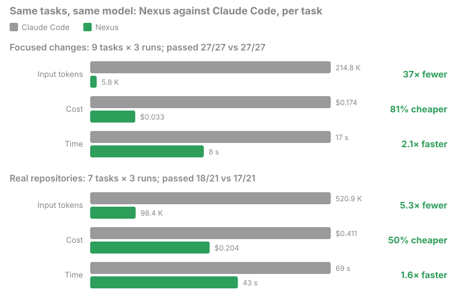
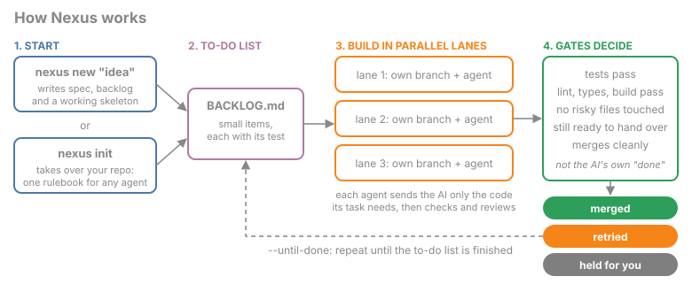

# Nexus-Agent

**Ship more code. Spend far less on tokens.**

> **Nexus builds software from a plain-English to-do list, many tasks at once, and merges a change only when tests and
> checks pass.**
>
> It indexes your repository once and sends the AI only the code each task needs: against Claude Code, on the same
> tasks with the same model, it used 37× fewer tokens and cost 81% less on focused changes, and 38% less on real
> repositories, passing as many tasks or more.
>
> It works with any model; with DeepSeek it built a whole project from one sentence for about 6 cents.



## How it works



1. **Start.** `nexus new "idea"` writes a spec, a to-do list and a working skeleton. `nexus init` takes over a
   repository you already have. Either way, every coding agent (Nexus, Claude Code, Codex, Cursor, Copilot, Gemini)
   gets the same instructions.
2. **To-do list.** `BACKLOG.md` holds small items, each naming the behaviour its test checks.
3. **Build in parallel lanes.** Each item gets its own branch and agent. Items that touch different code run at the
   same time.
4. **Gates decide.** A change merges only if its checks pass. A failed change is retried, and one that keeps failing
   is held for you. `--until-done` repeats until the list is finished.

## Stop paying your agent to read your repository

Most coding agents find their way by reading: search, open a file, open another, and so on. Every file they read is
billed as input tokens, and stays in the conversation, billed again, on every later turn. You pay for the agent's
exploration, not for the change.

**Nexus reads your repository once, into an index**: every function, class, import and caller, across about 35 languages and config formats.
For each task it looks up the few pieces of code that matter and sends only those. Less to read means fewer tokens,
a smaller bill, and less noise for the model.

**Measured on the same tasks, with the same model (Claude), against Claude Code**, using hidden tests the agent never
sees ([full report](benchmarks/REPORT.md)):

| | Claude Code | Nexus | Saving |
|---|---|---|---|
| **Focused changes** (9 tasks in 6 languages × 3 runs) | | | |
| Input tokens per task | 214.8 K | **5.8 K** | **37× fewer** |
| Cost per task | $0.174 | **$0.033** | **81% cheaper** |
| Time per task | 17 s | **8 s** | **2.1× faster** |
| Passed | 27/27 | **27/27** | same quality |
| **Real repositories** (7 bug fixes and features in click, cobra and a Next.js site, × 3 runs) | | | |
| Input tokens per task | 525.6 K | **139.3 K** | **3.8× fewer** |
| Cost per task | $0.391 | **$0.243** | **38% cheaper** |
| Time per task | 62 s | 66 s | about the same |
| Passed | 17/21 | **18/21** | one more |

**Bring a cheaper model and the savings multiply.** Nexus works with any model: Claude, OpenAI, Gemini, DeepSeek, or a
local one. With DeepSeek V4.1 Flash it passed 25/27 focused changes at **$0.001 a task**, and 13/21 real-repository
tasks at **$0.012 a task**, about 33× cheaper than Claude Code's $0.391. On those harder tasks it passes fewer, so use
it where the price matters more than the last few percent.


**From one sentence to a finished project for about 6 cents.** [examples/readlist](examples/README.md) is a Python
command-line tool Nexus built from a single sentence with DeepSeek: 6 features, 31 passing tests, every commit and
every decision recorded, including the two jobs its checks rejected and it then retried.

## Why you can trust what it merges

- **It does not take the AI's word for it.** A change merges only when tests, lint, typecheck and build pass, no risky
  file (CI, deploy, auth, dependencies) was touched, and it merges cleanly. In the example run, an agent approved its
  own work while a test was failing; the gate caught it.
- **It reviews its own work.** Before finishing, the agent rereads its full diff against the task and fixes what it
  finds.
- **It never pushes.** Approved work is merged locally; publishing is your call.
- **It keeps projects ready to hand over.** Any coding agent reads one set of instructions, there is a command for
  every check, and the tests and README stay current. `nexus handover` checks all of this.

## Get started

Needs **Node.js 22.18 or newer**; there is no build step.

```bash
git clone https://github.com/narinzar/nexus-agent
```
```bash
cd nexus-agent && npm install && npm link
```

Pick a model with `--model` (for example `claude-cli`, `anthropic:claude-sonnet-5-5`,
`openrouter:deepseek/deepseek-v4.1-flash-1017` or `ollama:qwen3-coder`). Then:

```bash
nexus new "a CLI that keeps a reading list in a JSON file" --build --until-done
```
```bash
nexus init
```
```bash
nexus lanes backlog --until-done --budget 5
```

- `nexus new` starts a project from an idea: spec, to-do list, a working skeleton, then the features.
- `nexus init` takes over a repository you already have.
- `nexus lanes backlog --until-done` builds until the to-do list is finished, within your budget.

## Learn more

| Read | For |
|---|---|
| [docs/guide.md](docs/guide.md) | every command, step by step: install, models, start, change, lanes |
| [examples/](examples/README.md) | the 6-cent project: every command, commit and job decision |
| [docs/lanes.md](docs/lanes.md) | how starting, handover, lanes and gates work, and who decides what |
| [docs/architecture.md](docs/architecture.md) | how the agent indexes code, builds context and stays safe |
| [benchmarks/REPORT.md](benchmarks/REPORT.md) | every benchmark number, per task, with the method ([how to rerun](benchmarks/README.md)) |
| [CONTRIBUTING.md](CONTRIBUTING.md) | how to add a language, model provider, skill or benchmark task |

## Project layout

| Path | What is inside |
|---|---|
| `src/lanes/` | start, hand over and build in lanes: `new`, `init`, `handover`, jobs and gates, environments, profile |
| `src/agent/` | the agent loop: send code, apply edits, verify, review |
| `src/repo-intel/` | the code index: languages, parsers, imports, SQLite store, queries |
| `src/context/` | what to send the model on each turn, and what went stale |
| `src/models/` | one interface for every AI provider, with token and cost accounting |
| `src/safety/` | permissions, workspace boundary, checkpoints, undo, logs |
| `src/skills/`, `skills/` | how-to guides loaded only when a task needs them |
| `src/memory/` | facts remembered between tasks |
| `src/benchmark/`, `benchmarks/` | the benchmark runner, suites, results, report and charts |
| `examples/`, `docs/`, `tests/` | the worked example, the docs, the tests (`npm run check`) |

## Credits and license

Built on tree-sitter, Node.js and the Agent Skills format. It adapts ideas from Aider, SWE-agent, SWE-bench, Codex
CLI, Cline, OpenHands and Pi, and from agentskill, harness2, ponytail, archify, graphify and the zazencodes software
factory. None of their code is used. The full list with licences is in [CREDITS.md](CREDITS.md).

[MIT](LICENSE)
