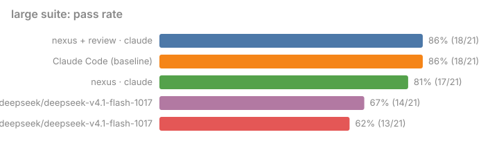
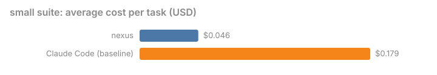
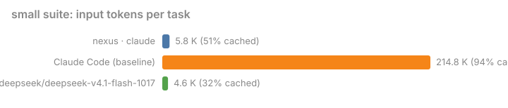

# Benchmark report

_Generated by `nexus bench report` from the raw files in [results/](results/). Do not edit by hand._

**Method**

- Each task runs in an isolated copy of its repository.
- Hidden acceptance tests are copied in only after the agent finishes, then the task's test command decides pass or fail.
- Large-suite tasks are real upstream fix commits. Each was validated to fail without a change and to pass with the upstream fix (`--variants none,oracle`).
- Costs are as reported by the provider (OpenRouter, Claude CLI).
- Input tokens include cache reads.

## Large suite: real repositories, upstream fix commits

Tasks: CK1, CK2, CK3, CB1, CB2, CB3, K2. Runs per task and configuration: 1. Source: [2026-11-22T01-54-44-large.json](results/2026-11-22T01-54-44-large.json).

| Configuration | Passed | Pass rate | Requests / task | Input tokens / task | Cache read | Output / task | Cost / task | Total cost | Time / task |
|---|---|---|---|---|---|---|---|---|---|
| nexus · claude | 4/7 | **57%** | 7.9 | 131.0 K | 87% | 3.1 K | $0.216 | $1.51 | 58 s |

Passes per task (out of runs):

| Task | nexus · claude |
|---|---|
| CK1 | 1/1 |
| CK2 | 0/1 |
| CK3 | 1/1 |
| CB1 | 0/1 |
| CB2 | 0/1 |
| CB3 | 1/1 |
| K2 | 1/1 |

## Small suite: multi-language fixtures

Tasks: P1, P2, P3, G1, G2, R1, C1, J1, K1. Runs per task and configuration: 1. Source: [2026-11-22T00-19-57-small.json](results/2026-11-22T00-19-57-small.json).

| Configuration | Passed | Pass rate | Requests / task | Input tokens / task | Cache read | Output / task | Cost / task | Total cost | Time / task |
|---|---|---|---|---|---|---|---|---|---|
| nexus | 9/9 | **100%** | 1.4 | 5.9 K | 25% | 503 | $0.046 | $0.41 | 8 s |
| Claude Code (baseline) | 9/9 | **100%** | 5.3 | 222.8 K | 94% | 213 | $0.179 | $1.61 | 17 s |

Passes per task (out of runs):

| Task | nexus | Claude Code (baseline) |
|---|---|---|
| P1 | 1/1 | 1/1 |
| P2 | 1/1 | 1/1 |
| P3 | 1/1 | 1/1 |
| G1 | 1/1 | 1/1 |
| G2 | 1/1 | 1/1 |
| R1 | 1/1 | 1/1 |
| C1 | 1/1 | 1/1 |
| J1 | 1/1 | 1/1 |
| K1 | 1/1 | 1/1 |

## Earlier runs

Single-run results from development (before repeats), kept for history:

- [2026-11-22T00-19-57-small.json](results/2026-11-22T00-19-57-small.json) (small): nexus 9/9, Claude Code (baseline) 9/9
- [2026-11-22T01-23-55-large.json](results/2026-11-22T01-23-55-large.json) (large): nexus · claude 4/7, Claude Code (baseline) 6/7, nexus · deepseek/deepseek-v4.1-flash-1017 5/7, nexus · qwen/qwen3.8-2.4t-a95b 2/7, nexus · meta/muse-spark-open 1/7, nexus · openai/gpt-6.2-sol 5/7
- [2026-11-22T01-32-43-large.json](results/2026-11-22T01-32-43-large.json) (large): nexus · claude 5/7
- [2026-11-22T01-54-44-large.json](results/2026-11-22T01-54-44-large.json) (large): nexus · claude 4/7

Suite validation (tests fail with no change, pass with the upstream fix): [2026-11-22T00-46-58-large-validation.json](results/2026-11-22T00-46-58-large-validation.json).

Narrative write-ups of those runs, including what changed between them: [reports/](reports/).
