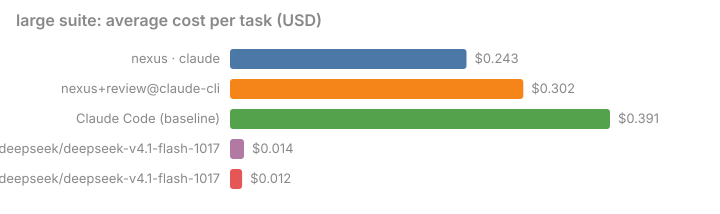
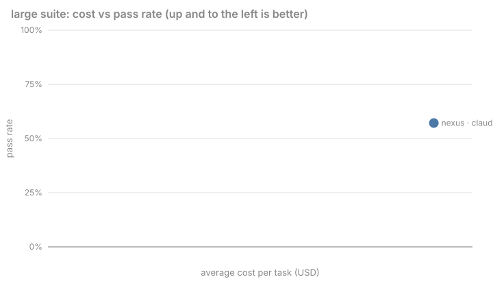
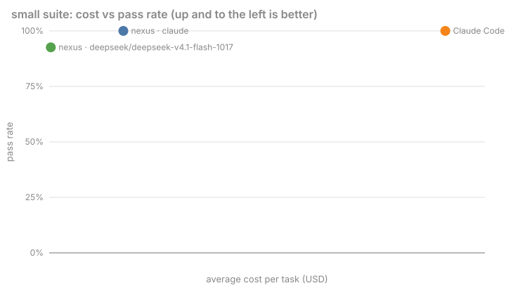

# Benchmark report

_Generated by `nexus bench report` from the raw files in [results/](results/). Do not edit by hand._

**Method**

- Each task runs in an isolated copy of its repository.
- Hidden acceptance tests are copied in only after the agent finishes, then the task's test command decides pass or fail.
- Large-suite tasks are real upstream fix commits. Each was validated to fail without a change and to pass with the upstream fix (`--variants none,oracle`).
- Costs are as reported by the provider (OpenRouter, Claude CLI).
- Input tokens include cache reads.

## Large suite: real repositories, upstream fix commits

Tasks: CK1, CK2, CK3, CB1, CB2, CB3, K2. Runs per task and configuration: 3. Source: [2026-11-25T01-59-50-large.json](results/2026-11-25T01-59-50-large.json), [2026-11-25T02-15-29-large.json](results/2026-11-25T02-15-29-large.json), [2026-11-22T03-33-22-large.json](results/2026-11-22T03-33-22-large.json), [2026-11-22T14-32-49-large.json](results/2026-11-22T14-32-49-large.json).

| Configuration | Measured | Passed | Pass rate | Requests / task | Input tokens / task | Cache read | Output / task | Cost / task | Total cost | Time / task |
|---|---|---|---|---|---|---|---|---|---|---|
| nexus + review · claude | 2026-11-22 | 18/21 | **86%** | 9.3 | 184.1 K | 86% | 3.5 K | $0.302 | $6.34 | 76 s |
| Claude Code (baseline) | 2026-11-25 | 18/21 | **86%** | 10.6 | 520.9 K | 95% | 380 | $0.411 | $8.64 | 69 s |
| nexus · claude | 2026-11-25 | 17/21 | **81%** | 6.5 | 98.4 K | 83% | 2.8 K | $0.204 | $4.29 | 43 s |
| nexus + review · deepseek/deepseek-v4.1-flash-1017 | 2026-11-22 | 14/21 | **67%** | 15.4 | 266.0 K | 89% | 21.8 K | $0.014 | $0.30 | 112 s |
| nexus · deepseek/deepseek-v4.1-flash-1017 | 2026-11-22 | 13/21 | **62%** | 14.4 | 275.6 K | 89% | 25.1 K | $0.012 | $0.25 | 135 s |

Passes per task (out of runs):

| Task | nexus + review · claude | Claude Code (baseline) | nexus · claude | nexus + review · deepseek/deepseek-v4.1-flash-1017 | nexus · deepseek/deepseek-v4.1-flash-1017 |
|---|---|---|---|---|---|
| CK1 | 3/3 | 3/3 | 3/3 | 3/3 | 2/3 |
| CK2 | 0/3 | 0/3 | 0/3 | 0/3 | 0/3 |
| CK3 | 3/3 | 3/3 | 3/3 | 2/3 | 3/3 |
| CB1 | 3/3 | 3/3 | 3/3 | 3/3 | 3/3 |
| CB2 | 3/3 | 3/3 | 2/3 | 1/3 | 1/3 |
| CB3 | 3/3 | 3/3 | 3/3 | 2/3 | 2/3 |
| K2 | 3/3 | 3/3 | 3/3 | 3/3 | 2/3 |

## Small suite: multi-language fixtures

Tasks: P1, P2, P3, G1, G2, R1, C1, J1, K1. Runs per task and configuration: 3. Source: [2026-11-22T02-14-40-small.json](results/2026-11-22T02-14-40-small.json).

| Configuration | Measured | Passed | Pass rate | Requests / task | Input tokens / task | Cache read | Output / task | Cost / task | Total cost | Time / task |
|---|---|---|---|---|---|---|---|---|---|---|
| nexus · claude | 2026-11-22 | 27/27 | **100%** | 1.4 | 5.8 K | 51% | 460 | $0.033 | $0.88 | 8 s |
| Claude Code (baseline) | 2026-11-22 | 27/27 | **100%** | 5.1 | 214.8 K | 94% | 261 | $0.174 | $4.69 | 17 s |
| nexus · deepseek/deepseek-v4.1-flash-1017 | 2026-11-22 | 25/27 | **93%** | 1.8 | 4.6 K | 32% | 748 | $0.001 | $0.02 | 5 s |

Passes per task (out of runs):

| Task | nexus · claude | Claude Code (baseline) | nexus · deepseek/deepseek-v4.1-flash-1017 |
|---|---|---|---|
| P1 | 3/3 | 3/3 | 3/3 |
| P2 | 3/3 | 3/3 | 3/3 |
| P3 | 3/3 | 3/3 | 2/3 |
| G1 | 3/3 | 3/3 | 2/3 |
| G2 | 3/3 | 3/3 | 3/3 |
| R1 | 3/3 | 3/3 | 3/3 |
| C1 | 3/3 | 3/3 | 3/3 |
| J1 | 3/3 | 3/3 | 3/3 |
| K1 | 3/3 | 3/3 | 3/3 |

## New projects from one sentence

Each idea goes through `nexus new --build --until-done` (openrouter:deepseek/deepseek-v4.1-flash-1017). The result is then cloned fresh, set up from nothing, and every check and the handover check run on the clone. This measures whether the project is finished and works, not how good its design is. Source: [2026-11-25T01-54-42-new.json](results/2026-11-25T01-54-42-new.json).

**3/6 projects finished** (fresh clone passes every check, backlog empty); 5/6 pass every check; 53/56 backlog items merged; total cost $0.53 ($0.089 per project); 10.1 min per project.

| Idea | Language | Fresh clone passes | Items merged | Held | Jobs (merged/run) | Test files | Cost | Time | Stopped because |
|---|---|---|---|---|---|---|---|---|---|
| N1 | python | yes | 9/9 | 0 | 9/10 | 3 | $0.046 | 6.9 min | backlog finished after 2 round(s) |
| N2 | typescript | yes | 6/7 | 1 | 6/9 | 1 | $0.067 | 10.7 min | only held items are left after 2 round(s) |
| N3 | go | yes | 11/11 | 0 | 11/13 | 2 | $0.070 | 7.3 min | backlog finished after 4 round(s) |
| N4 | rust | **no**: checks pass | 7/8 | 1 | 7/12 | 6 | $0.141 | 12.7 min | only held items are left after 3 round(s) |
| N5 | javascript | yes | 8/9 | 1 | 8/11 | 2 | $0.067 | 9.6 min | only held items are left after 3 round(s) |
| N6 | python | yes | 12/12 | 0 | 12/17 | 5 | $0.140 | 13.3 min | backlog finished after 5 round(s) |

Ideas: [suites/new.json](suites/new.json).

## Earlier runs

Development runs and runs replaced by a newer measurement of the same configuration, kept for history:

- [2026-11-22T03-33-22-large.json](results/2026-11-22T03-33-22-large.json) (large, replaced by a newer run): nexus · claude 18/21, $0.243 and 66 s per task; Claude Code (baseline) 17/21, $0.391 and 62 s per task
- [2026-11-22T00-19-57-small.json](results/2026-11-22T00-19-57-small.json) (small): nexus 9/9, Claude Code (baseline) 9/9
- [2026-11-22T01-23-55-large.json](results/2026-11-22T01-23-55-large.json) (large): nexus · claude 4/7, Claude Code (baseline) 6/7, nexus · deepseek/deepseek-v4.1-flash-1017 5/7, nexus · qwen/qwen3.8-2.4t-a95b 2/7, nexus · meta/muse-spark-open 1/7, nexus · openai/gpt-6.2-sol 5/7
- [2026-11-22T01-32-43-large.json](results/2026-11-22T01-32-43-large.json) (large): nexus · claude 5/7
- [2026-11-22T01-54-44-large.json](results/2026-11-22T01-54-44-large.json) (large): nexus · claude 4/7

Suite validation (tests fail with no change, pass with the upstream fix): [2026-11-22T00-46-58-large-validation.json](results/2026-11-22T00-46-58-large-validation.json).

Narrative write-ups of those runs, including what changed between them: [reports/](reports/).
